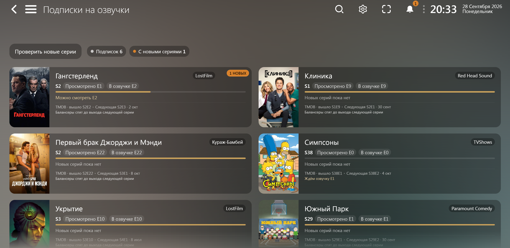
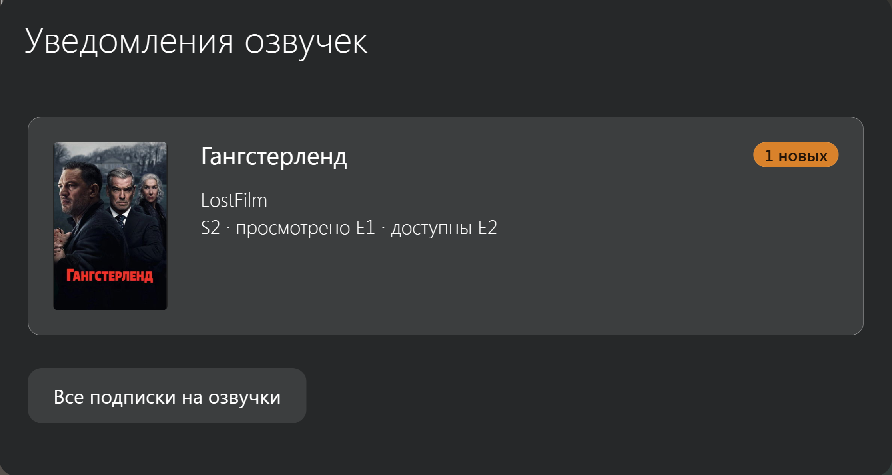
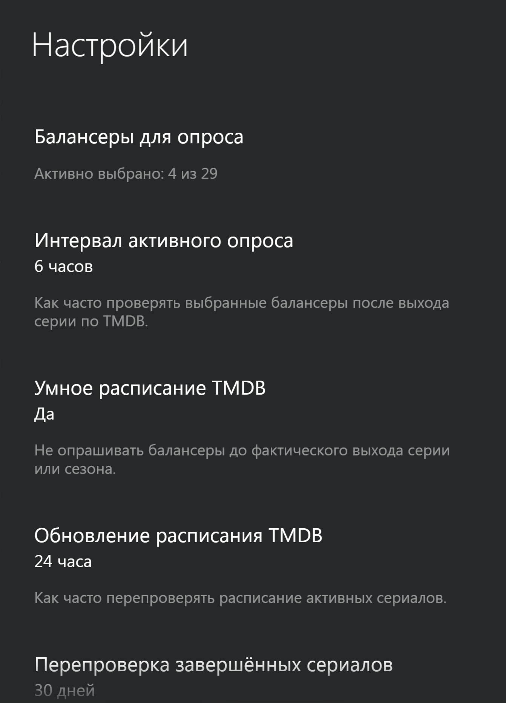
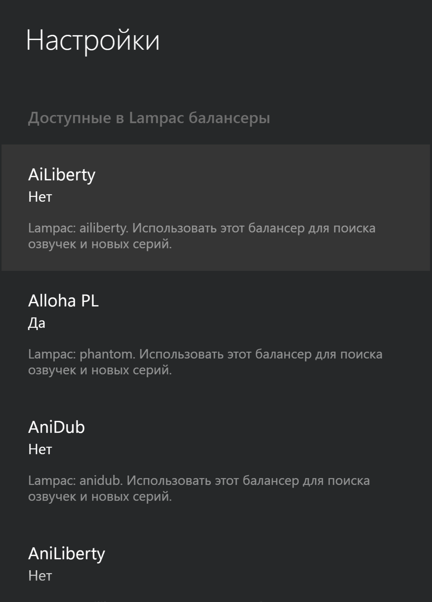
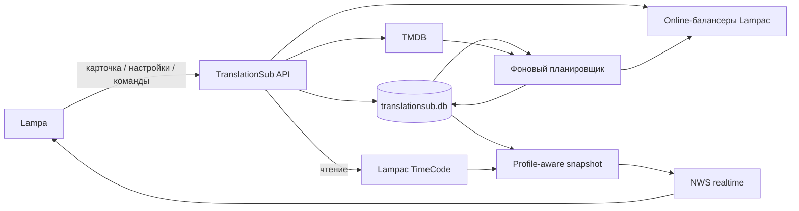

<div align="center">

# 🎙️ TranslationSub

**Подписки на конкретные озвучки сериалов для Lampac**

Отслеживает появление новых эпизодов в выбранной озвучке через Online-балансеры Lampac, учитывает расписание TMDB и синхронизирует просмотр с TimeCode.

[](https://github.com/lampac-nextgen/lampac)


[](https://www.themoviedb.org/)
[](https://www.sqlite.org/)

[](LICENSE)

[Быстрый старт](#quick-start) •
[Возможности](#features) •
[Интерфейс](#interface) •
[Настройки](#settings) •
[Как работает](#how-it-works) •
[API](#api)

</div>

<p align="center">
  
  <br>
  <sub>Подписки на озвучки: сезон, просмотренная серия, доступная серия, источник и состояние TMDB</sub>
</p>

> [!NOTE]
> Подписка отслеживает доступность эпизодов **в конкретной озвучке**: выход серии в другом переводе не меняет состояние выбранной подписки.

---

<a id="features"></a>

## ✨ Возможности

- 🎙️ **Подписки на выбранные озвучки** из карточки сериала в Lampa.
- 🔎 **Поиск через Online-балансеры Lampac** с настройкой используемых источников.
- 🧩 **Объединение одинаковых озвучек** из нескольких балансеров с сохранением источников.
- 📺 **Страница подписок** с данными о сезоне, просмотренных и доступных эпизодах.
- 🔔 **Уведомления и индикаторы новых серий** в интерфейсе Lampa.
- ⚡ **Обновления через NWS** без ручной перезагрузки страницы.
- 🗓️ **Расписание TMDB** для планирования проверок с учётом дат выхода эпизодов.
- 🔄 **Сопровождение новых сезонов** с настраиваемой стратегией перехода.
- ▶️ **Интеграция с Lampac TimeCode** и независимый прогресс по профилям Lampa.
- 💾 **SQLite-хранилище** подписок, настроек, расписаний и прогресса просмотра.
- 🧷 **Автоподключение клиентского скрипта** при использовании Lampa через Lampac LampaWeb.

---

<a id="interface"></a>

## 🖼️ Интерфейс

### 🔔 Уведомления

<p align="center">
  
  <br>
  <sub>Уведомления об изменениях подписок с переходом к сериалу или списку подписок</sub>
</p>

<details>
<summary>⚙️ <b>Настройки и выбор балансеров</b></summary>

<br>

<table>
  <tr>
    <td width="50%" align="center">
      
      <br><sub>Интервалы, TMDB и новые сезоны (скриншот прежней версии настроек)</sub>
    </td>
    <td width="50%" align="center">
      
      <br><sub>Online-балансеры Lampac, участвующие в поиске озвучек</sub>
    </td>
  </tr>
</table>

</details>

---

<a id="quick-start"></a>

## 🚀 Быстрый старт

**1. Добавьте репозиторий TranslationSub в конфигурацию загрузчика модулей Lampac.**

В каталоге работающей установки создайте `mods/repository.yaml` либо дополните существующий файл:

```yaml
- repository: https://github.com/ivzaislu/TranslationSub
  branch: main
  modules:
    - "."
```

Значение `"."` указывает на корень репозитория: исходники модуля находятся непосредственно в нём.

> [!IMPORTANT]
> При наличии `mods/repository.yaml` Lampac использует его вместо `module/repository.yaml`. Если во втором файле уже описаны другие репозитории, сохраните их записи при переходе на первый.

**2. Перезапустите Lampac.**

При запуске встроенный `ModuleRepository` скачает исходники и разместит их в `module/TranslationSub`, без дополнительного вложенного каталога:

```text
<каталог Lampac>/
├── mods/
│   └── repository.yaml
├── module/
│   └── TranslationSub/
│       ├── manifest.json
│       ├── ModInit.cs
│       ├── ModuleConf.cs
│       ├── V2Controller.cs
│       ├── Models/
│       ├── Services/
│       ├── translationsub.js
│       └── translationsub-*.js
└── database/
    └── translationsub.db
```

При последующих запусках Lampac сравнивает состояние ветки `main` на GitHub и скачивает изменения при появлении нового коммита. Включение модуля и динамическая пересборка уже заданы в `manifest.json` (`enable: true`, `dynamic: true`).

**3. При необходимости переопределите серверную конфигурацию в `init.conf`.**

Пример секции, добавляемой в существующий корневой объект конфигурации:

```json
{
  "TranslationSub": {
    "enable": true,
    "check_interval_minutes": 15,
    "tmdb_apihost": "https://api.themoviedb.org/3"
  }
}
```

Значения по умолчанию уже определены в модуле; отдельная секция не обязательна.

**4. Проверьте загрузку клиентского скрипта** по адресу `/translationsub.js` на вашем сервере Lampac.

> [!NOTE]
> Если Lampa обслуживается через Lampac LampaWeb, клиентский скрипт подключается автоматически через `EventListener.AppReplace`. При независимом размещении Lampa может потребоваться отдельное подключение JS-плагина.

---

<a id="settings"></a>

## ⚙️ Настройки

Параметры подписок настраиваются в Lampa и сохраняются в серверной базе TranslationSub отдельно для каждого пользователя.

| Параметр | По умолчанию | Диапазон / варианты | Назначение |
|---|---:|---|---|
| Интервал проверки озвучки | 1 час | 1–24 часа | Период повторных запросов к балансерам, когда вышедший эпизод ещё не найден в выбранной озвучке |
| Расписание TMDB | Включено | Да / Нет | Учитывать даты выхода эпизодов при планировании обращений к источникам |
| Обновление данных TMDB | 24 часа | 6–168 часов | Интервал актуализации расписания активных сериалов |
| Новый сезон | `auto` | `auto`, `notify`, `off` | Стратегия отслеживания при переходе на следующий сезон |
| Балансеры в уведомлениях | Включено | Да / Нет | Показывать под сезоном и эпизодами источники, на которых доступна самая новая серия |
| Прямой переход к просмотру из уведомлений | Выключено | Да / Нет | Открывать Online в выбранном балансере, сезоне и озвучке вместо карточки сериала |
| Балансеры | Не выбраны | Доступные Online-модули Lampac | Источники поиска и проверки озвучек |

Плановые запросы к источникам выполняются при наличии подходящих подписок. Если доступны данные TMDB, модуль может отложить проверку до выхода очередного эпизода; принудительная проверка не ограничивается этим расписанием для активных сериалов.

**Балансеры в уведомлениях.** При включённой настройке под строкой «S2 · просмотрено E1 · доступны E2» показывается «Балансер: Collaps» или «Балансеры: Collaps, HDVB». Перечисляются только источники, где присутствует последняя доступная серия выбранной озвучки. Для старых подписок информация появится после успешной проверки источников. Выключение настройки скрывает строку, не влияет на проверки и не удаляет источники подписки.

**Прямой переход из уведомления (экспериментально).** По умолчанию отключён: нажатие по-прежнему открывает карточку сериала. После включения TranslationSub использует стандартный Online-компонент Lampac: передаёт выбор балансера, а сезон и имя озвучки предварительно записывает в его настройки. Если новая серия есть на нескольких балансерах, предложит выбрать один. Если Online-плагин отсутствует или сведений об источниках недостаточно, откроет обычную карточку. **Ограничение:** сезон в текущем Online-плагине задан индексом списка; при неполных или нестандартно отсортированных списках сезонов может потребоваться ручная корректировка. Автоматический запуск видеоплеера не выполняется.

**Управление пультом Lampa.** Для уведомлений и выбора Online-балансера используются штатные `Lampa.Modal` и `Lampa.Select`: стрелки переключают пункты, OK подтверждает выбор, а «Назад» из списка балансеров возвращает к тому же уведомлению без потери фокуса. Если выбран один балансер, отдельный список не открывается. Пользовательский интерфейс подписок использует стандартные `selector` и события `hover:enter`/`hover:long` — мышь не требуется.

**Завершённые и отменённые сериалы:** статусы TMDB `Ended`, `Canceled` и `Cancelled` приводят к автоматическому удалению всех подписок пользователя на сериал (включая сезоны и озвучки). Уже сохранённые конечные статусы обрабатываются без повторного запроса к TMDB. Связанный прогресс TranslationSub очищается, а база Lampac TimeCode не изменяется. Отдельной периодической перепроверки таких сериалов нет. Создать новую подписку на сериал с конечным статусом нельзя.

<details>
<summary>🆕 <b>Режимы нового сезона</b></summary>

<br>

| Режим | Поведение |
|---|---|
| `auto` | Автоматически создать подписку на следующий сезон с выбранной озвучкой |
| `notify` | Уведомить о начале нового сезона без автоматического перехода |
| `off` | Не выполнять автоматический переход на следующий сезон |

</details>

<details>
<summary>🛠️ <b>Серверные параметры Lampac</b></summary>

<br>

| Параметр | По умолчанию | Назначение |
|---|---:|---|
| `enable` | `true` | Включение серверных функций модуля |
| `check_interval_minutes` | `15` | Интервал запуска фонового цикла обработки подписок, в минутах |
| `tmdb_apihost` | `https://api.themoviedb.org/3` | Адрес API TMDB |
| `tmdb_apikey` | Встроенное значение | Ключ API TMDB; при необходимости переопределяется в `init.conf` |

**Планировщик и проверка озвучек работают с разными интервалами.** Параметр `check_interval_minutes` задаёт период запуска серверного цикла (минимум 5 минут). Во время каждого прохода модуль определяет, каким подпискам необходима проверка. Пользовательский интервал (1–24 часа) ограничивает повторные обращения к Online-балансерам для конкретной подписки; расписание TMDB дополнительно учитывает даты выхода эпизодов.

</details>

---

<a id="how-it-works"></a>

## 🧠 Как это работает



1. **Идентификация сериала.** Lampac определяет контент по данным карточки Lampa.
2. **Поиск озвучек.** TranslationSub получает варианты через выбранные Online-балансеры.
3. **Нормализация источников.** Совпадающие озвучки объединяются с сохранением доступных балансеров.
4. **Создание подписки.** Выбранная озвучка и параметры отслеживания сохраняются в SQLite.
5. **Планирование.** Фоновый цикл оценивает необходимость проверки с учётом пользовательского интервала и данных TMDB.
6. **Актуализация.** При появлении новых эпизодов обновляется доступный прогресс подписки.
7. **Синхронизация TimeCode.** Просмотренный прогресс читается из базы Lampac отдельно для каждого профиля.
8. **Уведомление.** При изменениях через NWS передаётся `TranslationSubChanged`, после чего клиент запрашивает актуальный snapshot.

<details>
<summary>🎙️ <b>Почему одна озвучка может иметь несколько источников</b></summary>

<br>

Названия озвучек нормализуются на сервере. Если озвучка доступна через несколько Online-балансеров, TranslationSub хранит одну подписку с перечнем источников. Подписка привязана к **озвучке**, а не к конкретному балансеру.

</details>

---

## 💾 Хранение и прогресс

Модуль использует две независимые базы SQLite.

**`database/translationsub.db`** — собственное хранилище TranslationSub с доступом на чтение и запись. Содержит пользовательские настройки, подписки, перечни источников, расписания TMDB и прогресс просмотра по профилям.

**`database/TimeCode.sql`** — штатная база Lampac, которую TranslationSub открывает **только для чтения** при синхронизации просмотренных эпизодов.

> [!NOTE]
> Эпизод считается просмотренным при прогрессе TimeCode **от 60%**. Прогресс каждого профиля хранится отдельно от общих сведений о подписке.

При обновлении исходников модуля содержимое `database/translationsub.db` не заменяется.

---

## ⚡ Realtime

Клиент регистрирует текущие `uid` и `profile_id` через Lampac NWS.

При изменении подписки или после успешной синхронизации TimeCode сервер публикует событие:

```text
TranslationSubChanged
```

После получения события клиент запрашивает актуальный snapshot и обновляет индикаторы. При восстановлении соединения NWS повторно регистрируется активный профиль.

---

<a id="api"></a>

## 🔌 API

<details open>
<summary><b>Основные endpoints</b></summary>

<br>

| Метод | Endpoint | Назначение |
|---|---|---|
| `GET` | `/translationsub/v2/snapshot` | Состояние подписок для текущего профиля |
| `POST` | `/translationsub/v2/content-state` | Состояние карточки и список озвучек |
| `POST` | `/translationsub/v2/subscriptions` | Создать подписку |
| `POST` | `/translationsub/v2/subscriptions/{id}/remove` | Удалить подписку |
| `POST` | `/translationsub/v2/check` | Принудительно проверить новые серии |
| `GET` / `POST` | `/translationsub/v2/settings` | Получить или изменить настройки |
| `GET` | `/translationsub.js` | Клиентский плагин Lampa |

</details>

---

## 🗂️ Структура модуля

<details>
<summary><b>Показать структуру</b></summary>

<br>

```text
TranslationSub/
├── Models/                    # модели подписок и состояния
├── Services/                  # хранение, планирование, интеграции
├── ModInit.cs                 # жизненный цикл и события Lampac
├── ModuleConf.cs              # серверная конфигурация
├── V2Controller.cs            # API подписок
├── SettingsController.cs      # настройки пользователя
├── PluginController.cs        # выдача клиентского скрипта
├── manifest.json              # параметры загрузки модуля
├── translationsub.js          # инициализация в Lampa
└── translationsub-*.js       # интерфейс, API, уведомления и NWS
```

</details>

## 🧩 Зависимости

- **[Lampac](https://github.com/lampac-nextgen/lampac)** с поддержкой dynamic modules и Online-балансеров;
- **Lampa** — пользовательский интерфейс;
- **TMDB** — расписание и сведения о выходе эпизодов;
- **Lampac TimeCode** — источник просмотренного прогресса;
- **Lampac NWS** — realtime-обновления;
- **SQLite** — локальное состояние TranslationSub.

## 🧪 Проверка совместимости

Совместимость с текущей веткой `main` [Lampac NextGen](https://github.com/ivzaislu/lampac-nextgen) проверяется в [GitHub Actions](.github/workflows/translationsub-integration.yml). Интеграционные сценарии охватывают SQLite/TimeCode, API подписок и настроек, объединение озвучек, отказоустойчивость балансеров и обмен событиями через NWS, включая изоляцию профилей и переподключение.

Для проверок внешних интеграций используются локальные заглушки Online-балансеров и TMDB.

## 📄 Лицензия

Проект распространяется по лицензии **MIT**. См. файл [`LICENSE`](LICENSE).

---

<div align="center">

TranslationSub — самостоятельный модуль для **[Lampac NextGen](https://github.com/lampac-nextgen/lampac)**.

</div>
